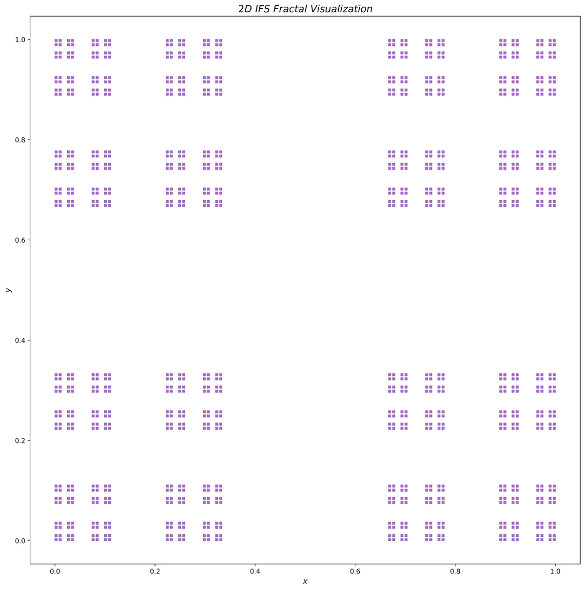
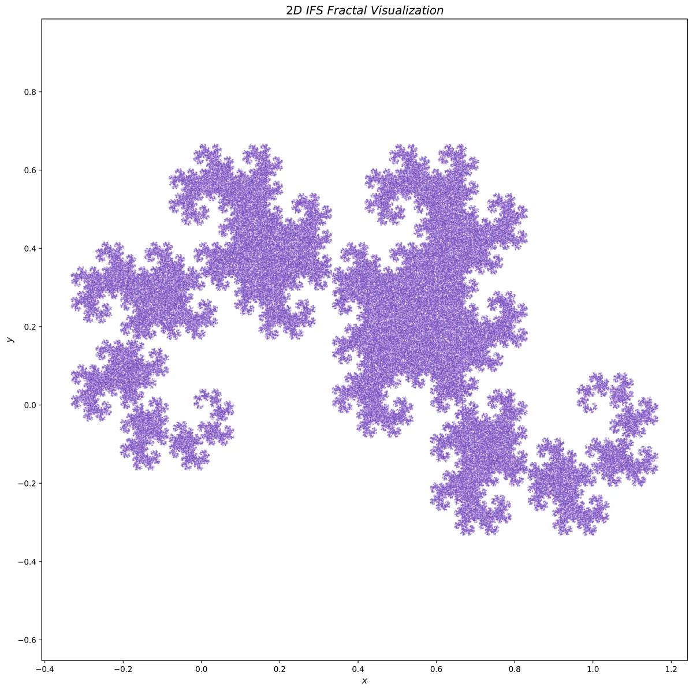
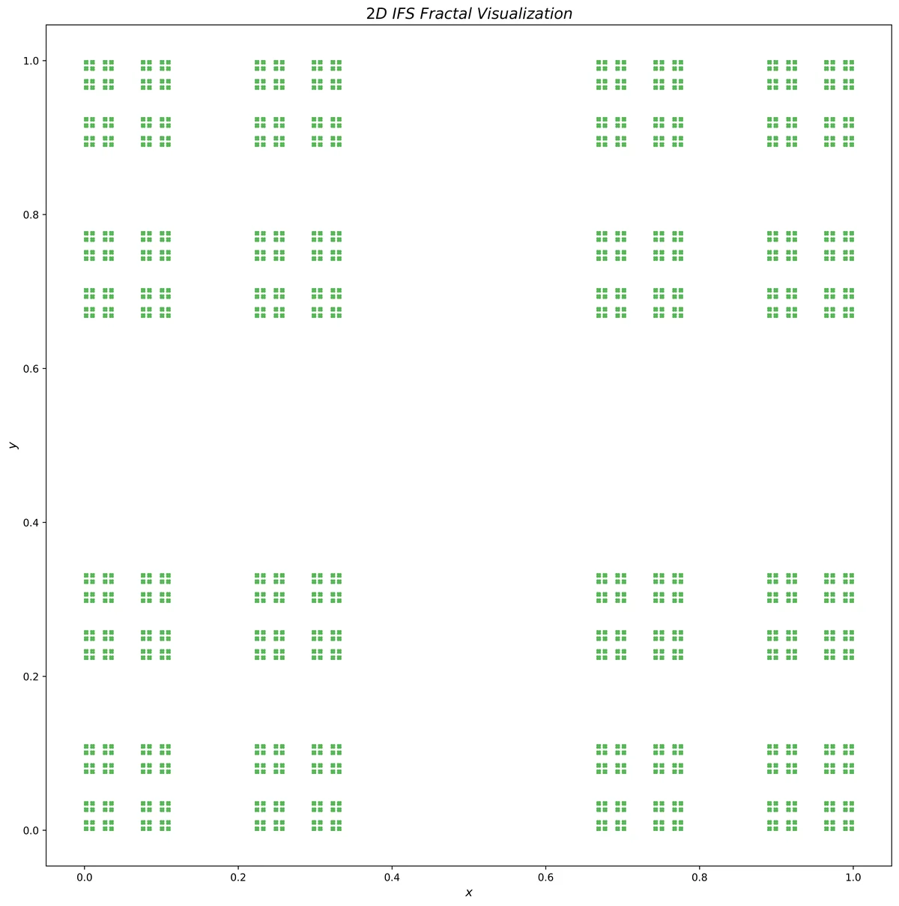
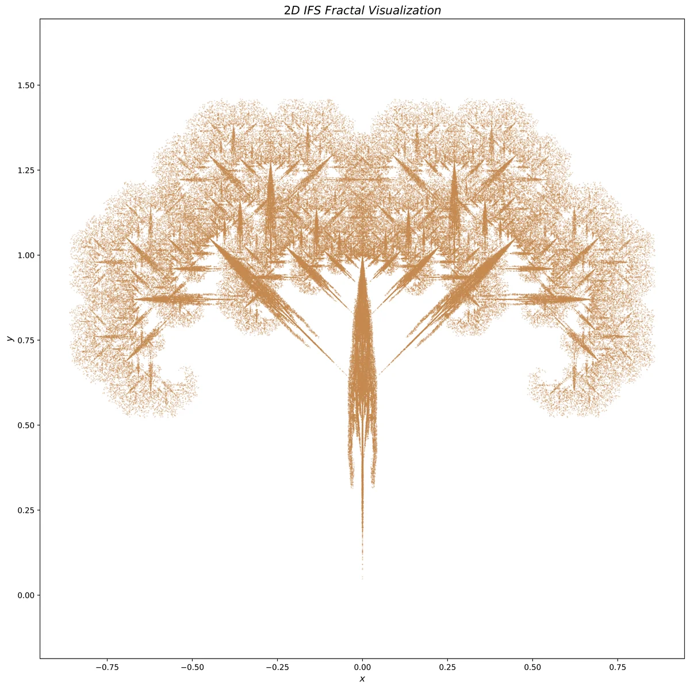
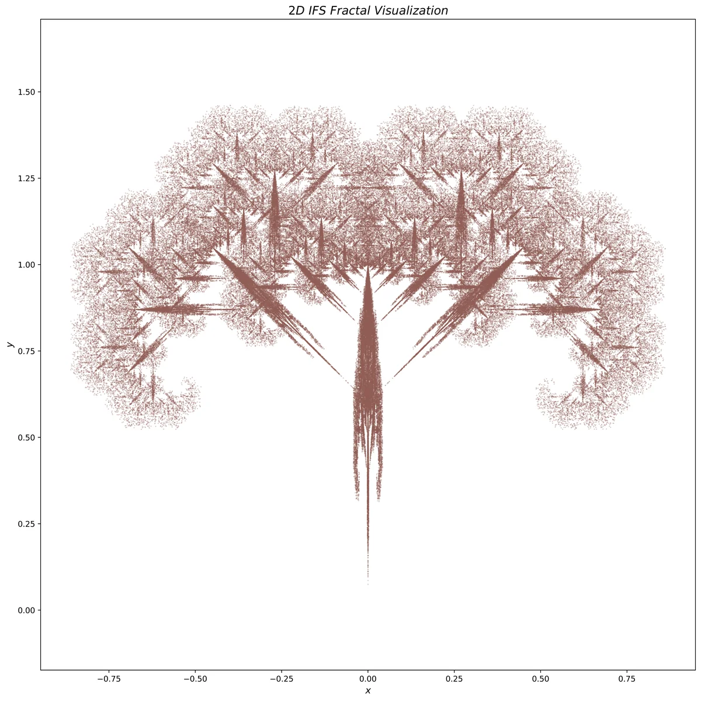
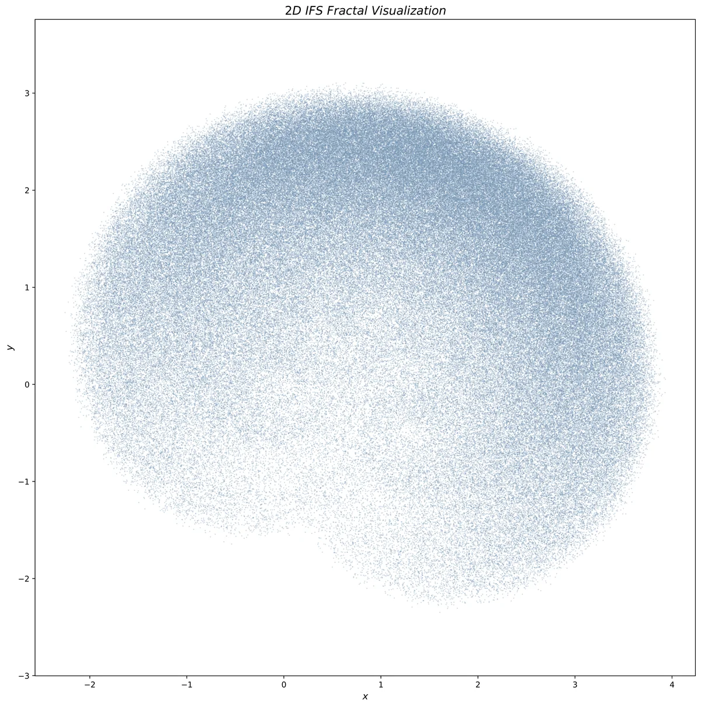
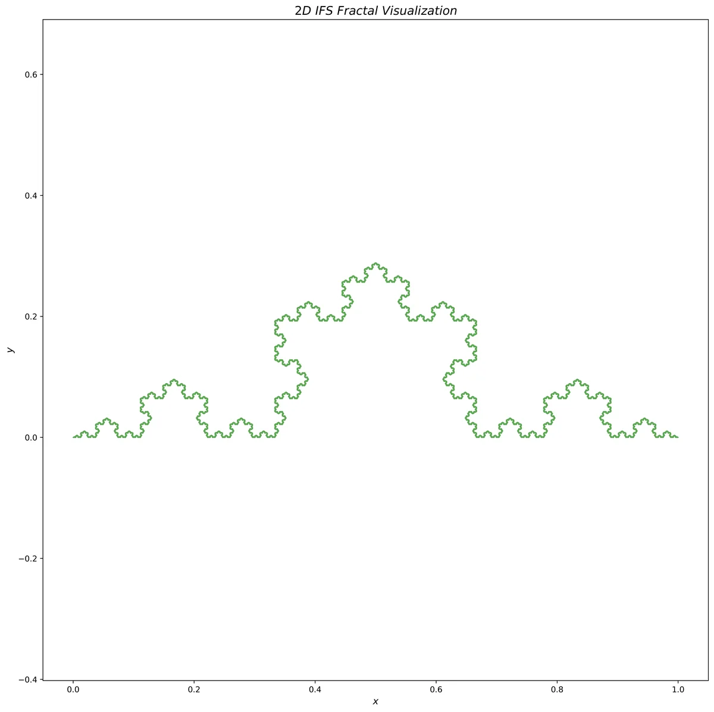
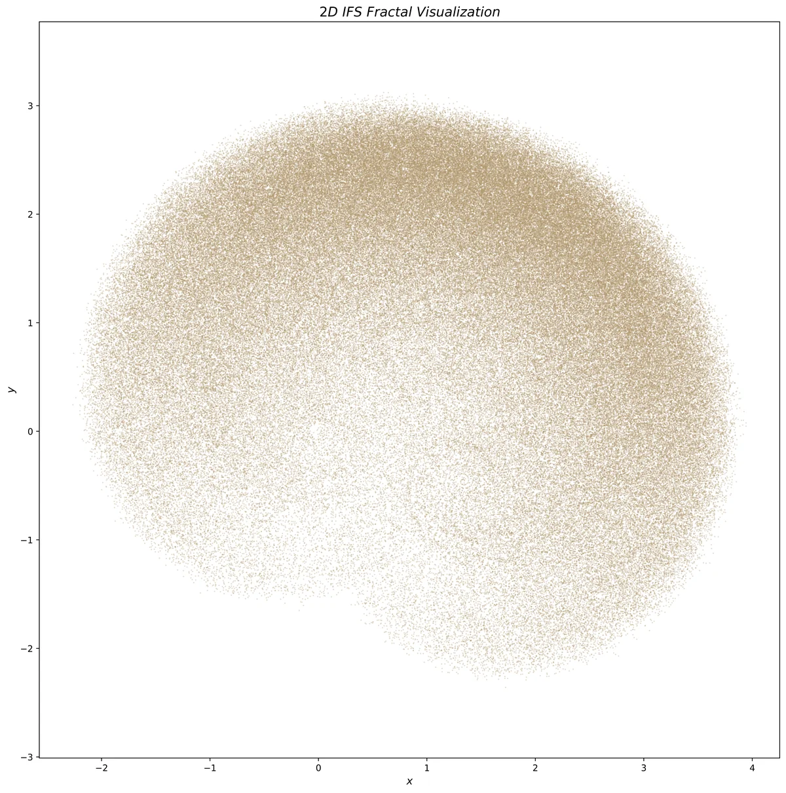

# 分形几何可视化：迭代函数系统（IFS）

[English](README.md) | **简体中文**

## 🌿 名字的由来：GoldenFern

**GoldenFern** 这个名字和我的 GitHub 头像都直接来源于这个项目。图片 `IFS.png`（金色蕨类）由 `IFS.py` 脚本的 `main` 代码块生成。

经典的巴恩斯利蕨（Barnsley Fern）虽然广为人知，但我用作头像的版本是经过定制的变体。通过调整仿射变换参数，并在叶片中引入基于正弦的非线性项，我得到了更具自然有机感、带有“金色”曲率的形态，它象征着数学与自然的交汇。

[](IFS.png)

## 📖 简介

本仓库提供了一个基于 Python 的二维分形几何可视化框架，使用**迭代函数系统（IFS）**。它实现了**混沌游戏（Chaos Game）**算法，能够从简单的压缩映射集合渲染出复杂的吸引子。

### 功能特点

- **高分辨率渲染**：使用 `matplotlib` 导出高 DPI 静态图片。
- **交互式探索**：使用 `plotly` 的 WebGL（`Scattergl`）实现对包含数百万个点的分形进行实时缩放和平移。
- **预置分形**：内置巴恩斯利蕨、谢尔宾斯基三角形、科赫曲线、龙形曲线、莱维 C 曲线等定义。
- **随机分形生成器**：以程序化方式生成独特且数学上有效的压缩映射。

## 🖼️ 图库

以下是使用本脚本生成的部分分形示例（位于 `examples/` 目录）。点击任意图片可查看全分辨率 PNG：

<p align="center">
  <a href="examples/20251204_134247.png"></a>
  <a href="examples/20251204_134307.png"></a>
  <a href="examples/20251204_134537.png"></a>
  <a href="examples/20251204_134610.png"></a>
</p>

<p align="center">
  <a href="examples/20251204_134319.png"></a>
  <a href="examples/20251204_134645.png"></a>
  <a href="examples/20251204_134702.png"></a>
  <a href="examples/20251204_134353.png"></a>
</p>

## 🚀 快速开始

### 环境要求

请确保已安装 Python 3.8 或更高版本，并安装所需的库：

```bash
pip install numpy matplotlib plotly
```

### 使用方法

1. **生成头像（金色蕨）：**
   直接按原样运行脚本：
   
   ```bash
   python IFS.py
   ```
2. **生成其他分形：**
   修改 `if __name__ == "__main__":` 代码块以使用不同的定义：
   
   ```python
   # 示例：生成龙形曲线
   visualizer = IFSVisualizer(*define_dragon_curve())
   visualizer.generate_points(n_total=500000, m_discard=1000)
   visualizer.plot_matplotlib(save=True, color="blue")
   ```

## 🧮 数学原理

### 1. 迭代函数系统（IFS）

迭代函数系统是完备度量空间 $\mathbb{X}$ 上有限个压缩映射 $f_1, f_2, \dots, f_n$ 的集合。本项目关注 $\mathbb{R}^2$ 中的仿射变换：

$$
f_i(x) = A_i x + b_i
$$

其中 $A_i$ 是 $2 \times 2$ 矩阵，$b_i$ 是平移向量。要使系统具有“压缩性”，每个 $f_i$ 的 Lipschitz 常数必须小于 1。

根据 **Hutchinson 定理**，存在唯一的非空紧集 $A \subset \mathbb{X}$，称为**吸引子**，满足：

$$
A = \bigcup_{i=1}^{n} f_i(A)
$$

本脚本使用的**混沌游戏**算法通过随机选取起点 $x_0$，并迭代应用 $x_{k+1} = f_{\sigma_k}(x_k)$ 来逼近该集合 $A$。其中 $\sigma_k$ 按概率分布 $p_i$ 从 $\lbrace 1, \dots, n \rbrace$ 中随机选取。

### 2. Hausdorff 测度与维数

标准欧几里得几何（长度、面积、体积）无法描述分形的复杂性。为此，我们使用 **Hausdorff 测度**。

对于集合 $F \subset \mathbb{R}^n$ 和实数 $s \ge 0$，$s$ 维 Hausdorff 测度 $\mathcal{H}^s(F)$ 定义为：

$$
\mathcal{H}^s(F) = \lim_{\delta \to 0} \inf \left\lbrace \sum_{i=1}^{\infty} |U_i|^s : F \subset \bigcup_{i=1}^{\infty} U_i, |U_i| < \delta \right\rbrace
$$

其中 $|U_i|$ 表示集合 $U_i$ 的直径。

**Hausdorff 维数** $d_H(F)$ 是使测度 $\mathcal{H}^s(F)$ 从 $\infty$ 跳变到 $0$ 的唯一 $s$ 值：

$$
d_H(F) = \inf\lbrace s : \mathcal{H}^s(F) = 0 \rbrace = \sup\lbrace s : \mathcal{H}^s(F) = \infty \rbrace
$$

对于许多 IFS 分形（如谢尔宾斯基三角形），其维数是非整数（例如 $\log 3 / \log 2 \approx 1.585$），它刻画了该分形填充空间的能力强于一条线、但弱于一个平面。
